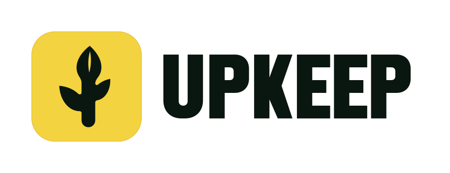
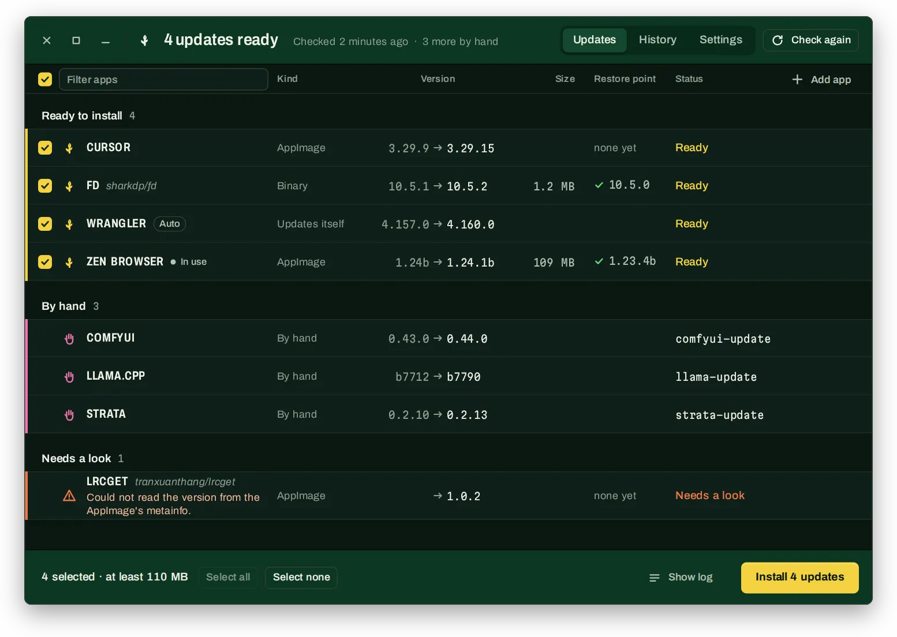
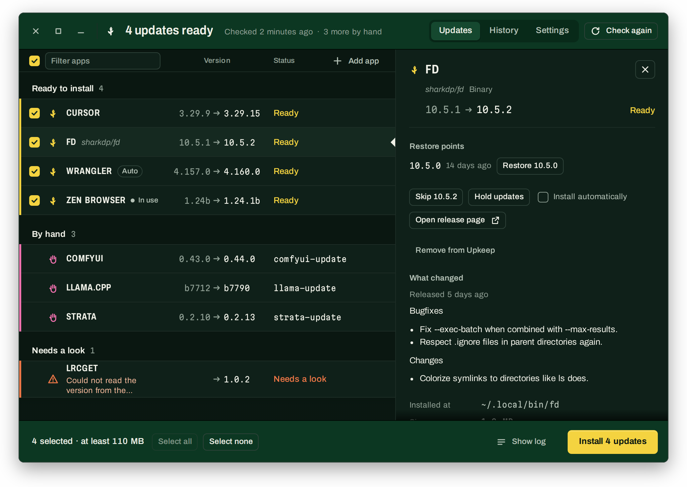
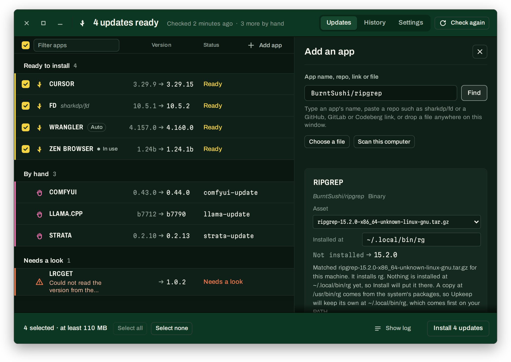
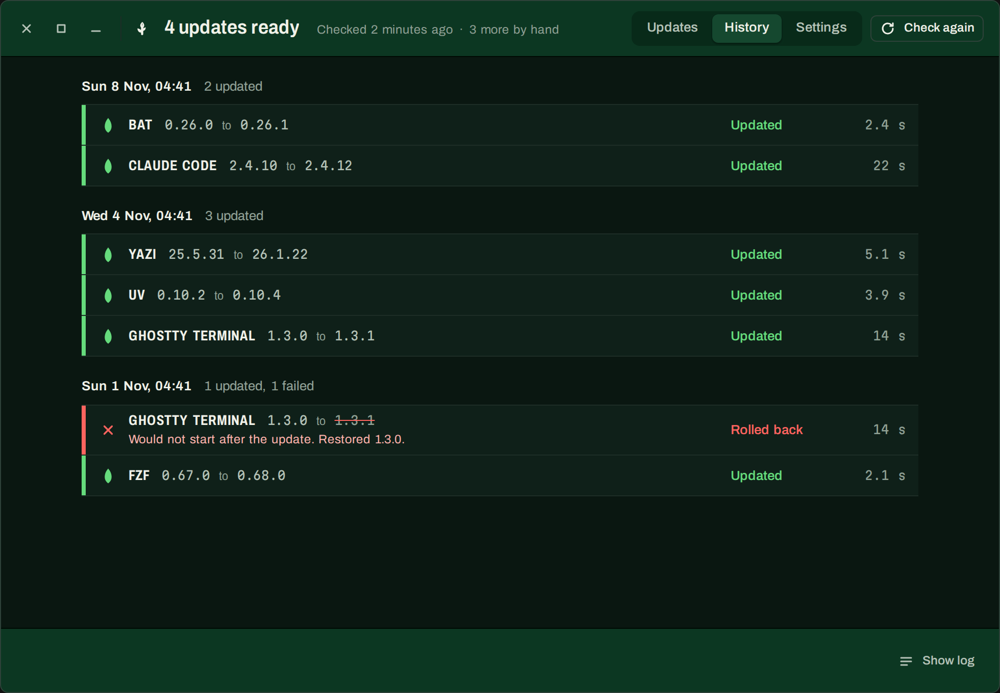
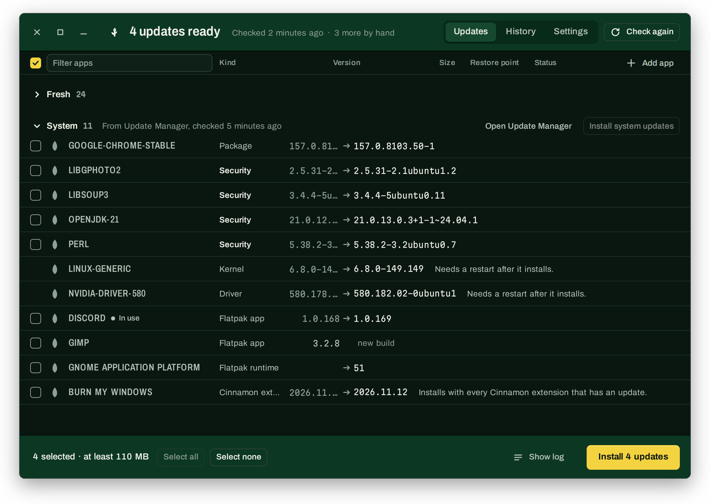
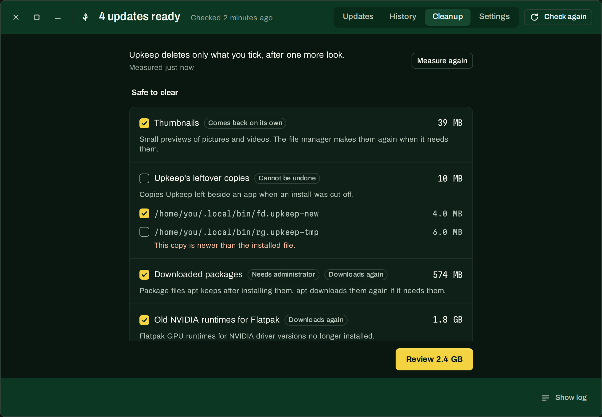
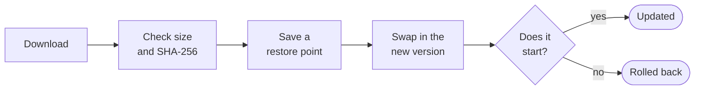

<p align="center">
  <picture>
    <source media="(prefers-color-scheme: dark)" srcset="assets/brand/lockup-horizontal-dark.svg">
    
  </picture>
</p>

<p align="center">
  <strong>The update manager for the apps your package manager misses</strong>
</p>

<p align="center">
  AppImages, release binaries, .deb and .rpm files, source builds and tools that update themselves.<br>
  One list, one press to install, and a way back when an update goes wrong.
</p>

<p align="center">
  
  
  
  
  
</p>

<p align="center">
  <a href="#install">Install</a> ·
  <a href="#tour">Tour</a> ·
  <a href="#what-it-updates">What it updates</a> ·
  <a href="#how-an-update-stays-safe">Safety</a> ·
  <a href="#works-on">Works on</a> ·
  <a href="#docs">Docs</a>
</p>

<p align="center">
  
</p>

Your distro's updater keeps its own packages current. Everything you installed yourself stays at the version it had that day: the AppImage from a release page, the binary you dropped in `~/.local/bin`, the tool you built from source. Upkeep checks all of them at once, shows the old and new version of each, and installs what you tick with one press.

## What it does

- **One list, one decision.** Every app is checked together. Tick what you want, press Install and walk away: nothing asks a question once the run starts, and each row shows its own step and progress.
- **A way back.** The version an update replaces is kept as a restore point. An update that will not start is rolled back on the spot, and any restore point can be put back later from the app's pane.
- **It works out the details.** Type an app's name, paste a repo or a link, drop a file, or scan the computer. Upkeep finds the release file that fits this machine, where the app is installed and which version you have. 1130 apps come ready-made in its catalogue.
- **It knows where apps come from.** Releases on GitHub, GitLab, Codeberg and self-hosted Gitea or Forgejo, plain download pages, and tools installed with uv, pipx, npm or cargo.
- **Quiet.** It sits in the tray, can start at login, and shows one count and one notification. No app installs on its own until you mark it automatic.
- **Extras you switch on.** The system's own updates in the same list (Flatpak, Snap, Cinnamon spices, and packages from Linux Mint's Update Manager, apt, dnf, pacman or zypper) and a Cleanup tab for caches and leftovers. Both are off until you turn them on.
- **Yours.** No account and no telemetry. Upkeep contacts only the places your apps are released. The app list is one TOML file you can read, edit and move to another computer.
- **It updates itself, carefully.** A new version of Upkeep is downloaded and started once as a test beside the one you have. Only a version that came up is swapped in, and the old one comes back if the new one will not start.
- **Ten languages**, and a command line with JSON output for scripts.

## Install

Download the installer for your machine from the [latest release](../../releases/latest) (`linux-x64` or `linux-arm64`), then:

```sh
tar -xzf linux-x64-Upkeep-Setup.tar.gz
./installer
```

It needs no root. Upkeep goes under `~/.local/share/dev.afk.upkeep/` with an entry in the menu. **Uninstall Upkeep** at the end of Settings removes it with its menu and login entries and the `upkeep` command, and can delete its settings and app list too; the apps it kept up to date stay. The window needs WebKitGTK 4.1, which the supported desktops already have.

The list starts empty. Press **Add app**, or **Scan this computer** to find what is already installed.

<details>
<summary>Build it from source</summary>

```sh
bun install
bun run build        # writes artifacts/linux-x64-Upkeep-Setup.tar.gz
```

Unpack that file and run `./installer`. [docs/develop.md](docs/develop.md) has the rest.

</details>

## Tour

### Read what changed before you install it

<p></p>

Ready updates are ticked, apps you update yourself show the command you use, and anything Upkeep could not read says why. An app's pane has its release notes and its restore points, and lets you skip one version, hold the app where it is, or let it install on its own from now on.

### Add an app without writing a config

<p></p>

Give Upkeep a name, a repo, a link or a file. The card says which release file fits this machine, where it will go and what is already installed, in one plain sentence. Nothing is added until you press Add, and removing an app from the list never uninstalls it.

### See every run, and every rollback

<p></p>

History keeps each run with what changed and how long it took. When an update fails its check, the row says what happened and which version was put back.

### System updates in the same list

<p></p>

Switch on **Show system updates** and the list gains the computer's own pending updates, read from the system's tools. A second switch lets Upkeep install the ones it safely can: it shows every command first and leaves kernels and drivers to the system's updater.

### Clear what piles up

<p></p>

The Cleanup tab measures a fixed list of caches and leftovers, never a folder you point it at. It deletes only what you tick, after a review that names the total and every command it will run.

## What it updates

| You have                                                | Upkeep updates it by                                                              |
| ------------------------------------------------------- | --------------------------------------------------------------------------------- |
| An AppImage                                             | downloading the new one from its release and swapping it in                       |
| A program from a release archive (`.tar.gz`, `.zip`)    | unpacking the programs the archive holds over the installed ones                  |
| A single-file binary                                    | replacing the file                                                                |
| A `.deb` or `.rpm` from a release page                  | installing it through `dpkg` or `rpm`                                             |
| An app built from source                                | fetching the new tag, running your build steps beside the live copy, then testing |
| A tool with its own updater (uv, pipx, npm, cargo, bun) | running that updater, and keeping a restore point where it can                    |
| Claude Code plugins                                     | updating every installed plugin in one row                                        |
| Something you update yourself                           | tracking it: you see the new version and the command you use                      |

A program your system's package manager owns is left alone. [The app list](docs/app-list.md) has every field a table takes, and [Apps built from source](docs/source-builds.md) has the long form.

## How an update stays safe



- The new file is written beside the old one and renamed into place, so a full disk or a cut connection leaves the old version whole.
- A running app is not closed. It keeps working, and its row says to restart it when you are ready.
- Steps that need root use `sudo -n`. Where sudo wants a password the app fails with a message and nothing is changed; Upkeep never asks for one in the middle of a run.
- An update that was cut off midway is not forgotten: the app's row says so and points at its restore point.

[What an install does](docs/how-an-install-works.md) has each step in full, and where Upkeep keeps its files.

## Works on

Built and used daily on Linux Mint. Each of these was run as a normal user: the window drew, a check ran, and the System group listed what the system's own tool showed.

| Distribution                      | Also covers                                 |
| --------------------------------- | ------------------------------------------- |
| Linux Mint 22                     |                                             |
| Ubuntu 26.04                      | Pop!\_OS, Zorin OS, elementary OS, KDE neon |
| Debian 13                         | MX Linux                                    |
| Fedora 45                         | Nobara, Ultramarine                         |
| Arch Linux                        | CachyOS, EndeavourOS, Manjaro               |
| openSUSE Tumbleweed and Leap 16.0 | Slowroll                                    |

- **Architectures:** x86_64 and aarch64.
- **Not supported:** immutable systems (SteamOS, Bazzite, Fedora Silverblue), NixOS, and musl systems such as Alpine.
- **Not yet tried:** Wayland sessions, the tray on desktops other than Cinnamon, and real arm64 hardware (the arm64 build has only run under emulation).
- **Planned, not built:** macOS and Windows.

[Which Linux](docs/linux-support.md) says what each part needs.

## Command line

The engine also runs without the window. Turn on **Add the upkeep command** in Settings and Upkeep puts `upkeep` in `~/.local/bin`:

```sh
upkeep check              # one line per app: OK, UPDATE, HELD, SKIP or BROKEN
upkeep install fd zen     # install named apps, or --all, or --auto
upkeep restore fd         # put back the newest restore point
upkeep add sharkdp/fd     # a catalogue name, a repo, a link or a file
upkeep export upkeep.json # settings and app list as one file
```

From a checkout of this repo, `bun run cli` takes the same commands.

Every command takes `--json` and prints one JSON value per line, so a script or an agent can manage Upkeep without editing a file. [Command line](docs/command-line.md) has all of them.

## Docs

| Page                                                 | What is in it                                                           |
| ---------------------------------------------------- | ----------------------------------------------------------------------- |
| [Adding an app](docs/adding-apps.md)                 | the five ways in, and how Upkeep picks a release file                   |
| [The app list](docs/app-list.md)                     | `apps.toml`: every kind, every field, where releases can come from      |
| [Apps built from source](docs/source-builds.md)      | build steps, stages, services to restart, tests, restore points         |
| [The catalogue](docs/catalogue.md)                   | the ready-made app tables, and how to add one                           |
| [What an install does](docs/how-an-install-works.md) | download, restore point, install, verify, and where files live          |
| [The window](docs/window.md)                         | frame, buttons and corners, moving to another computer, languages       |
| [System updates](docs/system-updates.md)             | what the System group reads and what Upkeep will install                |
| [Cleanup](docs/cleanup.md)                           | every item it measures and how each is deleted                          |
| [Which Linux](docs/linux-support.md)                 | what each part needs, and the distributions it was run on               |
| [Command line](docs/command-line.md)                 | every command, exit codes, JSON output for scripts and agents           |
| [Updating Upkeep](docs/updating-upkeep.md)           | how Upkeep updates itself, what keeps that safe, and the way out        |
| [Develop](docs/develop.md)                           | run from a checkout, build the installer, the checks a change must pass |

## Contributing

The quickest way to help is to add an app you use: one small TOML file in `catalogue/`, written the way it works on your machine. A test loads every file, so a broken one cannot get in. [CONTRIBUTING.md](CONTRIBUTING.md) has the steps and the rules a change has to meet.

Found a bug, or an app Upkeep reads wrong? [Open an issue](../../issues) and include the row's message and the log from **Show log**.

Upkeep is built with AI assistance, and contributions from AI coding agents are welcome.

## License

Upkeep is free software under the GNU General Public License, version 3 or any later version. See [LICENSE](LICENSE). Anyone may use, change and share it; a changed copy that is given to others has to come with its source under the same license.

<p align="center">
  <sub>Built with <a href="https://electrobun.dev">Electrobun</a>, <a href="https://bun.sh">Bun</a>, <a href="https://svelte.dev">Svelte</a> and TypeScript.</sub>
</p>
